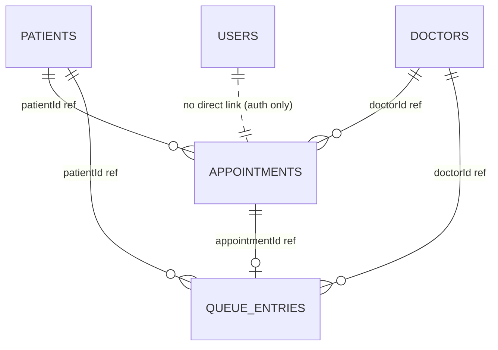

# Clinic Appointment and Patient Queue Management System

Academic full-stack web application for a **NoSQL Database Management System** course. It demonstrates MongoDB CRUD, embedded documents, references with `populate()`, aggregation pipelines, indexes, and Mongoose validation through a practical clinic workflow.

## Objectives

- Manage patients, doctors, and appointments with REST APIs.
- Run a **per-doctor daily queue** with safe queue-number allocation.
- Provide dashboard metrics and admin reports from MongoDB aggregations.
- Support **Administrator** and **Receptionist** roles with JWT authorization.

## Technology Stack

| Layer | Tools |
|--------|--------|
| Frontend | React (Vite), React Router, Axios, Recharts, Lucide React |
| Backend | Node.js, Express, Mongoose, JWT, bcryptjs |
| Database | MongoDB (`clinic_management`) |

## Architecture

```text
[React UI] --Axios/JWT--> [Express REST API] --Mongoose--> [MongoDB]
```

- The browser never talks to MongoDB directly; all data flows through the backend.
- Passwords are hashed with bcrypt; JWT carries role claims for authorization middleware.

## MongoDB Collections (5)

| Collection | Purpose |
|------------|---------|
| `users` | Staff login accounts |
| `patients` | Patient demographics (embedded contact & address) |
| `doctors` | Doctors (embedded weekly availability array) |
| `appointments` | Bookings referencing `patients` and `doctors` |
| `queue_entries` | Daily queue per doctor with timestamps |

Supporting collections (implementation detail, not part of the five demo collections):

- `queuecounters` — atomic `$inc` sequence per doctor/day for queue numbers.
- `idcounters` — atomic IDs for `PAT`, `DOC`, `APT` prefixes.

### Relationships (diagram)



### Embedded vs referenced

- **Embedded**: patient `contact`, patient `address`, doctor `availability` — small, fixed sub-documents that belong to one parent.
- **Referenced**: appointments and queue entries store ObjectIds — many appointments per patient/doctor; avoids unbounded arrays on patient documents.

### Queue number safety

Queue numbers use `QueueCounter.findOneAndUpdate` with `$inc` and a **unique compound index** on `(doctorId, queueDate, queueNumber)`. This avoids counting documents + 1 and prevents duplicate numbers under concurrent check-ins.

## Features by role

**Administrator:** dashboard, doctors CRUD, patients, appointments, queue, reports.

**Receptionist:** register/search patients, book appointments, check-in, queue operations (no doctor create/delete, no reports).

## Installation

### Prerequisites

- Node.js 18+
- MongoDB Community Server or MongoDB Atlas connection string

### 1. Clone / open project

```bash
cd clinic-appointment-system
```

### 2. Backend

```bash
cd backend
copy .env.example .env   # Windows
npm install
npm run seed             # loads demo data (safe to re-run)
npm run dev
```

Server: `http://localhost:5000`

### 3. Frontend

```bash
cd frontend
npm install
npm run dev
```

UI: `http://localhost:5173` (proxies `/api` to the backend)

### MongoDB configuration

Default URI in `.env`:

```env
MONGODB_URI=mongodb://127.0.0.1:27017/clinic_management
```

Use Compass to browse `clinic_management` after seeding.

## Demo credentials

| Role | Email | Password |
|------|--------|----------|
| Administrator | admin@clinic.com | Admin@123 |
| Receptionist | reception@clinic.com | Reception@123 |

## API endpoints

| Method | Path | Access |
|--------|------|--------|
| POST | `/api/auth/login` | Public |
| GET | `/api/auth/me` | Auth |
| GET/POST | `/api/patients` | Auth |
| GET/PUT/DELETE | `/api/patients/:id` | Auth (delete admin) |
| GET/POST | `/api/doctors` | Auth (write admin) |
| GET/PUT/DELETE | `/api/doctors/:id` | Auth (write admin) |
| GET/POST | `/api/appointments` | Auth |
| PUT | `/api/appointments/:id` | Auth |
| PATCH | `/api/appointments/:id/cancel` | Auth |
| GET | `/api/queue/today` | Auth |
| GET | `/api/queue/doctor/:doctorId` | Auth |
| POST | `/api/queue/check-in` | Auth |
| POST | `/api/queue/call-next` | Auth |
| PATCH | `/api/queue/:id/call` | Auth |
| PATCH | `/api/queue/:id/start-consultation` | Auth |
| PATCH | `/api/queue/:id/complete` | Auth |
| PATCH | `/api/queue/:id/no-show` | Auth |
| GET | `/api/dashboard/stats` | Auth |
| GET | `/api/analytics/*` | Admin |

## Database example scripts

Run in `mongosh` from the `database/` folder:

- `crud-examples.js` — insert, find, update, soft delete.
- `aggregation-examples.js` — `$group`, `$lookup`, `$project`, waiting-time average.
- `indexes.js` — unique and compound indexes used by the app.

## Common errors

| Issue | Solution |
|-------|----------|
| `MongoServerSelectionError` | Start MongoDB service or fix `MONGODB_URI` |
| 401 on API calls | Log in again; token may have expired |
| Appointment conflict | Choose a time inside doctor availability without overlap |
| Queue check-in rejected | Use an appointment scheduled for **today** with status Scheduled |

## Project structure

```text
clinic-appointment-system/
├── frontend/src/     # React pages and components
├── backend/            # Express API, models, seed
├── database/           # Standalone MongoDB demo scripts
└── README.md
```

## Viva talking points

1. **CRUD** — patient registration and appointment booking APIs.
2. **Embedding** — why phone/address live inside `patients`.
3. **References + populate** — appointment list shows patient/doctor names.
4. **Aggregation** — reports count by status, doctor, day; average wait time.
5. **Indexes** — unique IDs, doctor+date appointment lookup, queue compound unique index.
6. **Validation** — Mongoose enums, required fields, overlap checks in service layer.
